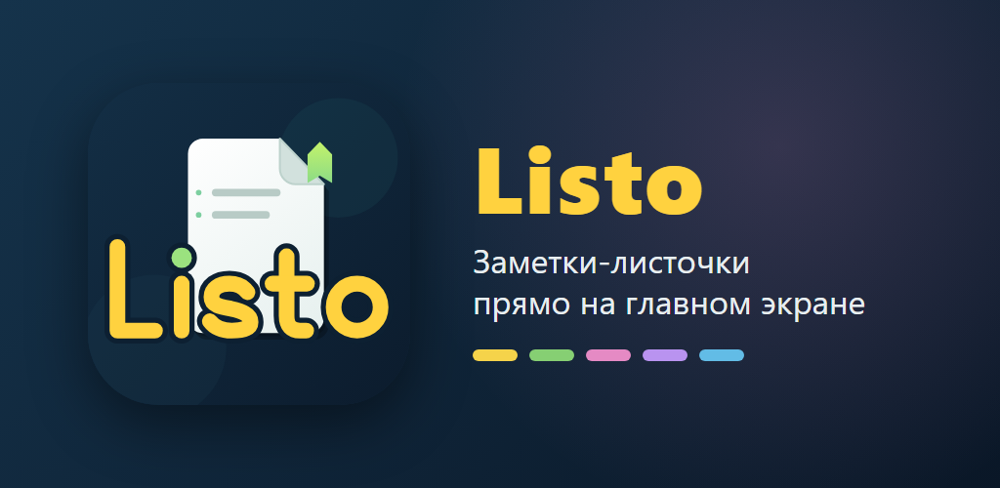

# Listo — заметки-листочки на главном экране



Простые и красивые заметки, которые можно прикрепить прямо на главный экран Android.

## Возможности
- Виджеты-листочки 4 размеров: маленький 2×1, средний 2×2, широкий 4×2, большой 4×4
- Форматирование: **жирный**, *курсив*, подчёркнутый и ~~зачёркнутый~~ текст
- Списки с маркерами, 7 цветов заметок, поиск, автосохранение
- Без рекламы, регистрации и сбора данных — заметки хранятся только на телефоне
- Нет разрешения на интернет

## Сборка
Нужен Android Studio (JDK 17+).

```
./gradlew assembleDebug
```

Готовый APK: `app/build/outputs/apk/debug/app-debug.apk`.

## Лицензия
[MIT](LICENSE)
